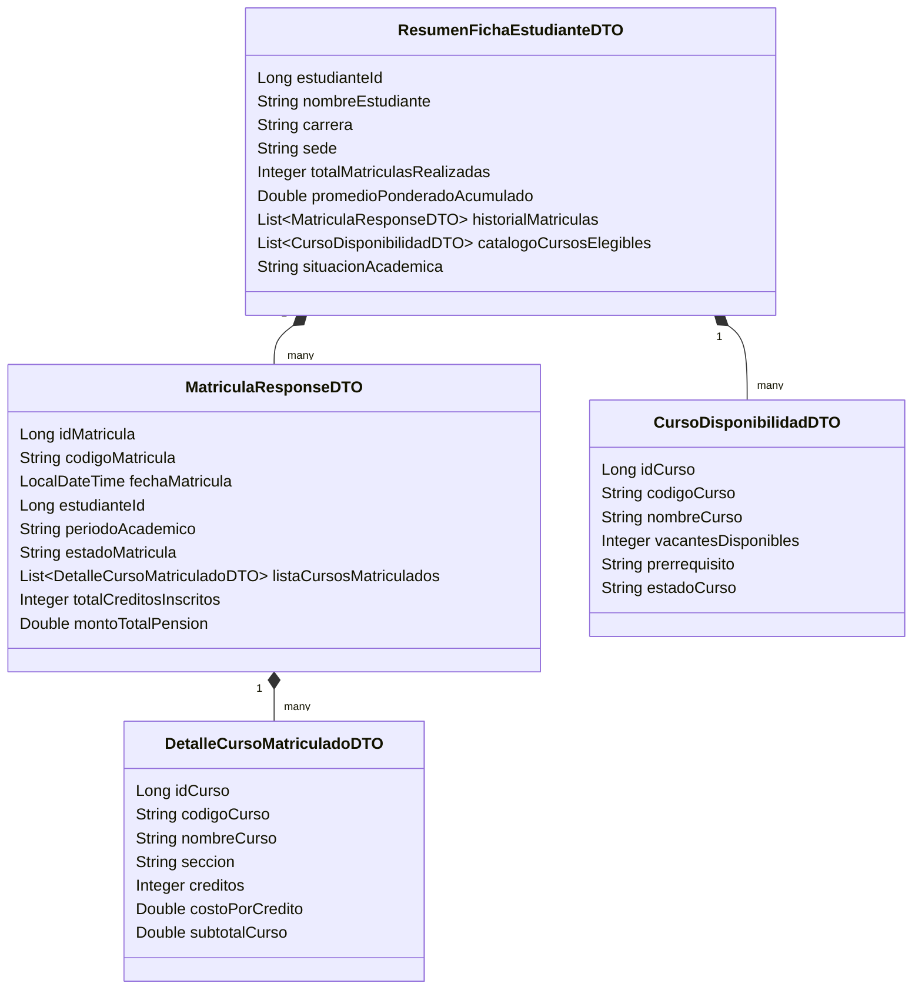

# EduSmart Campus – Microservicios con Spring Cloud

> **Curso:** 0268 – Desarrollo de Aplicaciones Web II · **Evaluación:** Laboratorio T2 (Fila B)
> **Profesor:** Luis Angel Salvatierra Aquino · **Semestre:** 2026-23 · **Ciclo:** Sexto
> **Grupo:** 10 · **Integrante:** Luis Fernando Fernandez Livaque

Plataforma de matrícula universitaria migrada de un monolito a una arquitectura de microservicios. Los clientes (web y móvil) solo hablan con el **API Gateway**, que ubica los servicios dinámicamente a través de **Eureka**. La configuración de cada sede se centraliza en un **Config Server nativo** con recarga en caliente vía **Actuator**.

---

## 1. Stack y versiones obligatorias

| Componente | Versión |
|---|---|
| Java | **25** |
| Spring Boot | **4.1.1** |
| Spring Cloud | **2025.1.3** |
| Build | Maven |
| Persistencia | Datos en memoria (repositorios con `ConcurrentHashMap`) |

> Cada proyecto vive en **su propio repositorio de GitHub** (requisito de la evaluación).

## 2. Repositorios

| # | Proyecto | Repositorio |
|---|---|---|
| 1 | `discovery-server-grupo10` | https://github.com/nandoxts/discovery-server-grupo10 |
| 2 | `api-gateway-grupo10` | https://github.com/nandoxts/api-gateway-grupo10 |
| 3 | `matricula-service-grupo10` | https://github.com/nandoxts/matricula-service-grupo10 |
| 4 | `curso-service-grupo10` | https://github.com/nandoxts/curso-service-grupo10 |
| 5 | `config-server-grupo10` | https://github.com/nandoxts/config-server-grupo10 |

---

## 3. Arquitectura

```mermaid
flowchart LR
    C[Cliente<br/>Postman / Web / App] -->|HTTP :8070| GW[api-gateway-grupo10<br/>:8070]

    subgraph Spring Cloud
        GW -->|lb://MATRICULA-SERVICE-GRUPO10| MS[matricula-service-grupo10<br/>:8085]
        GW -->|lb://CURSO-SERVICE-GRUPO10| CS[curso-service-grupo10<br/>:8086]
        MS -->|@FeignClient + LoadBalancer| CS
        EU[(discovery-server-grupo10<br/>Eureka :8761)]
        GW -. registro / descubrimiento .-> EU
        MS -. registro .-> EU
        CS -. registro .-> EU
    end

    CFG[config-server-grupo10<br/>:8888 · native] -->|propiedades edusmart.*| MS
    FS[(C:/edusmart-config/<br/>matricula-service-lima.yml<br/>matricula-service-arequipa.yml)] --> CFG
    ADM[Administrador] -->|POST /actuator/refresh| MS
```

### Mapa de puertos

| Servicio | Puerto | Nombre en Eureka | Rol |
|---|---|---|---|
| `config-server-grupo10` | 8888 | — (no se registra) | Configuración centralizada nativa |
| `discovery-server-grupo10` | 8761 | — (es el servidor) | Registro de servicios |
| `curso-service-grupo10` | 8086 | `CURSO-SERVICE-GRUPO10` | Catálogo, vacantes, prerrequisitos, costo por crédito |
| `matricula-service-grupo10` | 8085 | `MATRICULA-SERVICE-GRUPO10` | Matrículas, créditos, pensión, ficha del estudiante |
| `api-gateway-grupo10` | 8070 | `API-GATEWAY-GRUPO10` | Punto de entrada único |

### Orden de arranque

1. `config-server-grupo10` (matricula-service lo necesita al iniciar)
2. `discovery-server-grupo10`
3. `curso-service-grupo10`
4. `matricula-service-grupo10`
5. `api-gateway-grupo10`

Después de levantar todo, esperar ~30 s y verificar en http://localhost:8761 que aparezcan los 3 clientes con estado **UP**.

---

## 4. Plan de integraciones

| ID | Origen | Destino | Mecanismo | Pregunta |
|---|---|---|---|---|
| INT-01 | Gateway, matricula, curso | Eureka | Registro y descubrimiento (Eureka Client) | P1 |
| INT-02 | Cliente | Gateway → microservicios | Spring Cloud Gateway con rutas `lb://` | P1 |
| INT-03 | matricula-service | curso-service | `@FeignClient` + Spring Cloud LoadBalancer | P1 |
| INT-04 | matricula-service | config-server | Spring Cloud Config Client (`spring.config.import`) | P2 |
| INT-05 | Administrador | matricula-service | Actuator `POST /actuator/refresh` + `@RefreshScope` | P2 |

### INT-01 · Registro en Eureka

- **Servidor:** `@EnableEurekaServer`, no se registra a sí mismo (`register-with-eureka=false`, `fetch-registry=false`).
- **Clientes:** dependencia *Eureka Discovery Client* y `eureka.client.service-url.defaultZone=http://localhost:8761/eureka/`.
- El nombre en Eureka sale de `spring.application.name` en mayúsculas.
- **Verificación:** el dashboard de http://localhost:8761 muestra los 3 servicios **UP**.

### INT-02 · Enrutamiento del Gateway

| Ruta entrante | Destino | Predicate |
|---|---|---|
| `http://localhost:8070/api/v1/matriculas/**` | `lb://MATRICULA-SERVICE-GRUPO10` | `Path=/api/v1/matriculas/**` |
| `http://localhost:8070/api/v1/cursos/**` | `lb://CURSO-SERVICE-GRUPO10` | `Path=/api/v1/cursos/**` |

- El prefijo `lb://` delega la resolución de host y puerto a Eureka y aplica balanceo de carga.
- No se usa `StripPrefix` porque los controllers ya exponen el path completo `/api/v1/...`.
- **Verificación:** las mismas llamadas a `:8070` devuelven lo mismo que a `:8085` y `:8086`.

### INT-03 · matricula-service → curso-service (Feign)

```java
@FeignClient(name = "curso-service-grupo10")
public interface CursoClient {

    @GetMapping("/api/v1/cursos/{idCurso}")
    CursoDisponibilidadDTO obtenerCurso(@PathVariable("idCurso") Long idCurso);

    @GetMapping("/api/v1/cursos/estudiante/{estudianteId}")
    List<CursoDisponibilidadDTO> listarCursosPorEstudiante(@PathVariable("estudianteId") Long estudianteId);
}
```

| Endpoint consumidor (matricula) | Llamada Feign | Para qué |
|---|---|---|
| `GET /api/v1/matriculas/validar-y-confirmar/{idMatricula}` | `obtenerCurso(idCurso)` por **cada** curso del detalle | Validar vacantes y estado |
| `GET /api/v1/matriculas/ficha-estudiante/{estudianteId}` | `listarCursosPorEstudiante(estudianteId)` | Armar `catalogoCursosElegibles` |

- `@EnableFeignClients` en la clase principal de matricula-service.
- El `name` del Feign es el nombre registrado en Eureka, así que **no hay URLs fijas**.
- **Manejo de fallas:** si curso-service responde 404 o no está disponible, la validación se trata como fallida y la matrícula queda `RECHAZADA_SIN_VACANTES` (no se propaga un 500 al cliente).

### INT-04 · matricula-service → Config Server (nativo)

- **Config Server:** `@EnableConfigServer`, `spring.profiles.active=native`, `search-locations=file:///C:/edusmart-config/`.
- **Cliente:** `spring.config.import=optional:configserver:http://localhost:8888` y `spring.profiles.active=lima` (o `arequipa`).
- **Detalle clave:** los archivos se llaman `matricula-service-{perfil}.yml`, pero el servicio se registra como `matricula-service-grupo10`. Para no romper Eureka ni la búsqueda de configuración, se separan los dos nombres:

```properties
spring.application.name=matricula-service-grupo10   # nombre en Eureka
spring.cloud.config.name=matricula-service          # nombre del archivo en el Config Server
```

- **Verificación:** `http://localhost:8888/matricula-service/lima` devuelve las propiedades de Lima.

### INT-05 · Recarga en caliente (Actuator)

- matricula-service incluye `spring-boot-starter-actuator`.
- `ConfiguracionController` está anotado con `@RefreshScope` e inyecta `edusmart.*` y `spring.datasource.url` con `@Value`.
- Se expone `management.endpoints.web.exposure.include=refresh,health,info`.
- `POST http://localhost:8085/actuator/refresh` vuelve a leer el Config Server y recrea los beans `@RefreshScope` **sin reiniciar** el servicio. La respuesta lista las claves que cambiaron, por ejemplo `["edusmart.costo-credito"]`.

---

## 5. Contratos de datos (DTOs)

No se transfieren tipos primitivos sueltos ni `List<String>`. Todo viaja en DTOs anidados.



| DTO | Lo produce | Lo consume |
|---|---|---|
| `CursoDisponibilidadDTO` | curso-service | matricula-service (Feign), cliente |
| `DetalleCursoMatriculadoDTO` | matricula-service | cliente (dentro de `MatriculaResponseDTO`) |
| `MatriculaResponseDTO` | matricula-service | cliente, `ResumenFichaEstudianteDTO` |
| `ResumenFichaEstudianteDTO` | matricula-service | cliente |

> `CursoDisponibilidadDTO` se replica en ambos microservicios (mismo paquete `dto`), porque cada uno es un repositorio independiente.

---

## 6. Reglas de negocio

| Regla | Dónde | Fórmula / condición |
|---|---|---|
| RN-01 Subtotal por curso | matricula-service | `subtotalCurso = creditos × costoPorCredito` |
| RN-02 Total de créditos | matricula-service | `totalCreditosInscritos = Σ creditos` de `listaCursosMatriculados` |
| RN-03 Pensión | matricula-service | `montoTotalPension = Σ subtotalCurso` |
| RN-04 Confirmación | matricula-service + Feign | **Todos** los cursos con `vacantesDisponibles > 0` **y** `estadoCurso == "ABIERTO"` → `CONFIRMADA`; si alguno falla → `RECHAZADA_SIN_VACANTES` |
| RN-05 Situación académica | matricula-service | `promedioPonderadoAcumulado >= 11.0` → `REGULAR`; si no → `OBSERVADO` |
| RN-06 Total de matrículas | matricula-service | `totalMatriculasRealizadas = historialMatriculas.size()` |
| RN-07 Sede en la ficha | matricula-service | `sede` se toma de `edusmart.sede` (Config Server), integrando P1 con P2 |

Los totales (RN-02 y RN-03) **se calculan en cada consulta**, no se guardan, para que nunca queden desactualizados.

---

## 7. Datos de prueba (seed en memoria)

### curso-service

| idCurso | Código | Nombre | Sección | Créditos | Costo/crédito | Vacantes | Prerrequisito | Estado |
|---|---|---|---|---|---|---|---|---|
| 1 | DAW201 | Desarrollo de Aplicaciones Web II | T6AA | 4 | 120.00 | 15 | DAW101 | ABIERTO |
| 2 | BDA201 | Base de Datos Avanzada | T6AB | 3 | 120.00 | 8 | BDA101 | ABIERTO |
| 3 | ARQ301 | Arquitectura de Software | T6AC | 4 | 120.00 | 0 | DAW201 | CERRADO |
| 4 | MOV201 | Desarrollo de Aplicaciones Móviles | T6AD | 3 | 120.00 | 5 | Ninguno | ABIERTO |

Cursos por estudiante: `1001 → [1, 2, 4]` · `1002 → [1, 3]`

### matricula-service

**Estudiantes**

| estudianteId | Nombre | Carrera | Promedio ponderado |
|---|---|---|---|
| 1001 | Ana Torres Quispe | Ingeniería de Software | 15.4 |
| 1002 | Carlos Huamán Rojas | Computación e Informática | 9.8 |

**Matrículas**

| idMatricula | Código | Estudiante | Periodo | Estado inicial | Cursos | Créditos | Pensión |
|---|---|---|---|---|---|---|---|
| 1 | MAT-2026-0001 | 1001 | 2026-II | EN_PROCESO | 1, 2 | 7 | 840.00 |
| 2 | MAT-2026-0002 | 1002 | 2026-II | EN_PROCESO | 1, 3 | 8 | 960.00 |
| 3 | MAT-2026-0003 | 1001 | 2026-I | CONFIRMADA | 4 | 3 | 360.00 |

---

## 8. Configuración de cada proyecto

### 8.1 `config-server-grupo10` · Dependencias: Config Server

```properties
spring.application.name=config-server-grupo10
server.port=8888
spring.profiles.active=native
spring.cloud.config.server.native.search-locations=file:///C:/edusmart-config/
```

### 8.2 Archivos físicos en `C:/edusmart-config/`

> Copia de referencia en el repositorio `config-server-grupo10`, carpeta `edusmart-config/`. Copiarla a `C:/edusmart-config/` antes de levantar el Config Server.

> El enunciado los nombra `.properties`, pero su contenido está en sintaxis YAML. Se crean como **`.yml`** para que el Config Server los lea correctamente; el contenido es el mismo del enunciado.

**`matricula-service-lima.yml`**

```yaml
edusmart:
  sede: "Campus Lima Central"
  costo-credito: 120.00
  max-creditos-ciclo: 22
  mensaje-bienvenida: "Bienvenido al Sistema de Matrícula - Sede Lima (Grupo 10)"
  limite-cuotas-pago: 5
spring:
  datasource:
    url: jdbc:postgresql://localhost:5432/edusmart_lima_db
```

**`matricula-service-arequipa.yml`**

```yaml
edusmart:
  sede: "Campus Arequipa"
  costo-credito: 95.00
  max-creditos-ciclo: 20
  mensaje-bienvenida: "Bienvenido al Sistema de Matrícula - Sede Arequipa (Grupo 10)"
  limite-cuotas-pago: 4
spring:
  datasource:
    url: jdbc:postgresql://localhost:5432/edusmart_arequipa_db
```

> `spring.datasource.url` solo se **lee y muestra** en `/configuracion`. matricula-service no incluye dependencias JDBC/JPA, así que no intenta conectarse a PostgreSQL.

### 8.3 `discovery-server-grupo10` · Dependencias: Eureka Server

```properties
spring.application.name=discovery-server-grupo10
server.port=8761
eureka.client.register-with-eureka=false
eureka.client.fetch-registry=false
```

### 8.4 `api-gateway-grupo10` · Dependencias: Reactive Gateway, Eureka Discovery Client

```properties
spring.application.name=api-gateway-grupo10
server.port=8070
eureka.client.service-url.defaultZone=http://localhost:8761/eureka/

spring.cloud.gateway.server.webflux.routes[0].id=matricula-service
spring.cloud.gateway.server.webflux.routes[0].uri=lb://MATRICULA-SERVICE-GRUPO10
spring.cloud.gateway.server.webflux.routes[0].predicates[0]=Path=/api/v1/matriculas/**

spring.cloud.gateway.server.webflux.routes[1].id=curso-service
spring.cloud.gateway.server.webflux.routes[1].uri=lb://CURSO-SERVICE-GRUPO10
spring.cloud.gateway.server.webflux.routes[1].predicates[0]=Path=/api/v1/cursos/**
```

> Desde Spring Cloud 2025 el prefijo de rutas es `spring.cloud.gateway.server.webflux.*` (el antiguo `spring.cloud.gateway.routes` está deprecado).

### 8.5 `curso-service-grupo10` · Dependencias: Spring Web, Eureka Discovery Client, Lombok

```properties
spring.application.name=curso-service-grupo10
server.port=8086
eureka.client.service-url.defaultZone=http://localhost:8761/eureka/
```

### 8.6 `matricula-service-grupo10` · Dependencias: Spring Web, Eureka Discovery Client, OpenFeign, Config Client, Actuator, Lombok

```properties
spring.application.name=matricula-service-grupo10
server.port=8085
eureka.client.service-url.defaultZone=http://localhost:8761/eureka/

# Config Server
spring.profiles.active=lima
spring.cloud.config.name=matricula-service
spring.config.import=optional:configserver:http://localhost:8888

# Actuator
management.endpoints.web.exposure.include=refresh,health,info
# Evita recrear el cliente Eureka en cada refresh (en eureka-client 2.0.x provoca un error 500)
eureka.client.refresh.enable=false
```

---

## 9. Endpoints

Todas las llamadas del cliente van por el **Gateway (8070)**. La única excepción es `/actuator/refresh`, que se envía directo a matricula-service (8085), tal como pide el enunciado.

| Método | URL (vía Gateway) | Servicio | Respuesta |
|---|---|---|---|
| GET | `/api/v1/cursos/{idCurso}` | curso | `CursoDisponibilidadDTO` |
| GET | `/api/v1/cursos/estudiante/{estudianteId}` | curso | `List<CursoDisponibilidadDTO>` |
| GET | `/api/v1/matriculas/{idMatricula}` | matrícula | `MatriculaResponseDTO` |
| GET | `/api/v1/matriculas/validar-y-confirmar/{idMatricula}` | matrícula → curso (Feign) | `MatriculaResponseDTO` |
| GET | `/api/v1/matriculas/ficha-estudiante/{estudianteId}` | matrícula → curso (Feign) | `ResumenFichaEstudianteDTO` |
| GET | `/api/v1/matriculas/configuracion` | matrícula (Config Server) | JSON de configuración |
| POST | `http://localhost:8085/actuator/refresh` | matrícula | Claves actualizadas |

### Ejemplo: `GET /api/v1/matriculas/1`

```json
{
  "idMatricula": 1,
  "codigoMatricula": "MAT-2026-0001",
  "fechaMatricula": "2026-10-10T09:30:00",
  "estudianteId": 1001,
  "periodoAcademico": "2026-II",
  "estadoMatricula": "EN_PROCESO",
  "listaCursosMatriculados": [
    { "idCurso": 1, "codigoCurso": "DAW201", "nombreCurso": "Desarrollo de Aplicaciones Web II",
      "seccion": "T6AA", "creditos": 4, "costoPorCredito": 120.0, "subtotalCurso": 480.0 },
    { "idCurso": 2, "codigoCurso": "BDA201", "nombreCurso": "Base de Datos Avanzada",
      "seccion": "T6AB", "creditos": 3, "costoPorCredito": 120.0, "subtotalCurso": 360.0 }
  ],
  "totalCreditosInscritos": 7,
  "montoTotalPension": 840.0
}
```

### Ejemplo: `GET /api/v1/matriculas/configuracion`

```json
{
  "sede": "Campus Lima Central",
  "costoCredito": 120.0,
  "maxCreditosCiclo": 22,
  "mensajeBienvenida": "Bienvenido al Sistema de Matrícula - Sede Lima (Grupo 10)",
  "limiteCuotasPago": 5,
  "datasourceUrl": "jdbc:postgresql://localhost:5432/edusmart_lima_db"
}
```

### Errores

| Caso | Código | Cuerpo |
|---|---|---|
| Matrícula, curso o estudiante inexistente | 404 | `{ "timestamp", "status", "error", "mensaje", "path" }` |
| curso-service caído durante la validación | 200 | Matrícula con estado `RECHAZADA_SIN_VACANTES` |

Se manejan con un `@RestControllerAdvice` y una excepción `RecursoNoEncontradoException`.

---

## 10. Plan de pruebas

| # | Prueba | Request | Resultado esperado |
|---|---|---|---|
| T01 | Registro en Eureka | Abrir http://localhost:8761 | 3 instancias UP |
| T02 | Config Server responde | `GET :8888/matricula-service/lima` | Propiedades de Lima |
| T03 | Curso por id (Gateway) | `GET :8070/api/v1/cursos/1` | DAW201, 15 vacantes, ABIERTO |
| T04 | Cursos por estudiante | `GET :8070/api/v1/cursos/estudiante/1001` | 3 cursos (1, 2, 4) |
| T05 | Cálculo de totales | `GET :8070/api/v1/matriculas/1` | 7 créditos, 840.00 |
| T06 | Confirmación exitosa | `GET :8070/api/v1/matriculas/validar-y-confirmar/1` | `CONFIRMADA` |
| T07 | Rechazo por vacantes | `GET :8070/api/v1/matriculas/validar-y-confirmar/2` | `RECHAZADA_SIN_VACANTES` (curso 3 cerrado, 0 vacantes) |
| T08 | Ficha REGULAR | `GET :8070/api/v1/matriculas/ficha-estudiante/1001` | 2 matrículas, 3 cursos elegibles, `REGULAR`, sede "Campus Lima Central" |
| T09 | Ficha OBSERVADO | `GET :8070/api/v1/matriculas/ficha-estudiante/1002` | 1 matrícula, 2 cursos, `OBSERVADO` |
| T10 | Recurso inexistente | `GET :8070/api/v1/matriculas/999` | 404 con mensaje |
| T11 | Recarga en caliente | Ver sección 11 | 120.00 → 140.00 sin reiniciar |
| T12 | Cambio de sede | Cambiar a `spring.profiles.active=arequipa` y reiniciar | Sede Arequipa, 95.00 |

---

## 11. Demo de recarga en caliente

```bash
# 1. Consulta inicial → costoCredito = 120.0
curl http://localhost:8070/api/v1/matriculas/configuracion

# 2. Editar C:/edusmart-config/matricula-service-lima.yml
#    costo-credito: 120.00  →  costo-credito: 140.00   (guardar)

# 3. Disparar el refresh (directo al microservicio)
curl -X POST http://localhost:8085/actuator/refresh
# → ["edusmart.costo-credito"]

# 4. Verificar → costoCredito = 140.0, SIN reiniciar matricula-service
curl http://localhost:8070/api/v1/matriculas/configuracion
```

En PowerShell, usar `curl.exe` en lugar de `curl` o hacer el POST desde Postman.

---

## 12. Estructura de paquetes (microservicios)

```
pe.edu.cibertec.matricula            (o .curso)
├── MatriculaServiceApplication.java   @SpringBootApplication @EnableFeignClients
├── client/        CursoClient.java    (solo matricula-service)
├── controller/    MatriculaController.java, ConfiguracionController.java (@RefreshScope)
├── dto/           DTOs de la sección 5
├── model/         Matricula, DetalleMatricula, Estudiante   (Curso en curso-service)
├── repository/    Repositorios en memoria con datos seed
├── service/       Interfaces de servicio
│   └── impl/      Implementaciones con las reglas de negocio
└── exception/     RecursoNoEncontradoException, GlobalExceptionHandler
```

## 13. Buenas prácticas aplicadas

- Separación en capas: controller → service (interfaz + implementación) → repository.
- Entidades internas separadas de los DTOs expuestos.
- Inyección por constructor (`@RequiredArgsConstructor`), sin `@Autowired` en campos.
- Sin URLs fijas entre servicios: todo se resuelve por nombre lógico en Eureka.
- Totales calculados en la capa de servicio, nunca en el controller.
- Valores monetarios redondeados a 2 decimales.
- Manejo centralizado de errores con `@RestControllerAdvice`.
- Configuración por sede externalizada en el Config Server; nada de valores de sede en el código.
- Un repositorio por proyecto, con `.gitignore` de Maven/IDE.

## 14. Problemas frecuentes

| Síntoma | Causa | Solución |
|---|---|---|
| Gateway responde 503 | El servicio aún no aparece en Eureka | Esperar ~30 s o revisar el nombre en `lb://` |
| `/configuracion` sale vacío o falla al iniciar | Config Server apagado o `spring.cloud.config.name` incorrecto | Levantar el Config Server primero y revisar T02 |
| `/actuator/refresh` devuelve 404 | Actuator no expuesto | Revisar `management.endpoints.web.exposure.include` |
| El refresh devuelve `[]` | Archivo no guardado o ruta incorrecta | Revisar `search-locations` y la extensión `.yml` |
| Error de compatibilidad Boot/Cloud al iniciar | Verificador de versiones de Spring Cloud | `spring.cloud.compatibility-verifier.enabled=false` |
| `/actuator/refresh` devuelve 500 (`scopedTarget.eurekaClient`) | El refresh recrea el cliente Eureka y eureka-client 2.0.x falla | `eureka.client.refresh.enable=false` (ya incluido) |
| Feign lanza `UnknownHostException` | `name` del `@FeignClient` no coincide con Eureka | Usar `curso-service-grupo10` |

## 15. Supuestos

- El enunciado no fija el umbral del promedio ponderado: se usa **11.0** (nota aprobatoria en escala vigesimal). Se define como constante para cambiarlo fácilmente.
- Los archivos de configuración se crean como `.yml` porque su contenido es YAML.
- La persistencia es en memoria. El `datasource.url` solo se expone como dato de configuración.
- `validar-y-confirmar` solo valida y actualiza el estado; no descuenta vacantes, porque el enunciado no lo pide.
- Aunque la rúbrica de la P2 menciona GitHub, el enunciado exige el modo **native** (sistema de archivos local), que es el que se implementa.
